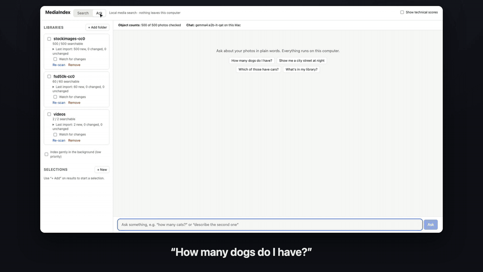

# MediaIndex

**Chat with your photos. Edit them. Offline.**

Ask your photo library questions, find what you describe, and remove or replace things in a photo, all on your Mac.
Nothing is uploaded: no account, no cloud, no telemetry.

**[⬇ Download for Mac (Apple silicon)](https://github.com/harsheetamorey/mediaindex/releases/latest)** · free and open source



Try asking:
- "how many dogs do I have?" counts them with an object detector and outlines each one
- "show me red cars" finds the cars, then checks the colour inside each one
- "remove the benches from photo 4" fills the space in from the photo around them
- "now replace them with one table instead" paints a new one, as a new file (your original never changes)

It also searches sounds and videos by description, and opens a video at the matching moment.

### Install
1. Download `MediaIndex-…-macos-arm64.zip` from [Releases](https://github.com/harsheetamorey/mediaindex/releases/latest),
   unzip it, and drag **MediaIndex** to Applications.
2. The first time, **right-click it → Open → Open**. (It isn't signed by Apple yet. On macOS 15, if that doesn't offer
   Open, go to System Settings → Privacy & Security and click **Open Anyway**.)
3. Choose whether to include photo editing, and it downloads the AI models once (1.6 GB, plus 2.7 GB for editing).
   After that it works offline.
4. Click **+ Add folder** and pick a folder of photos. You can search as soon as the first ones are indexed.

Needs an Apple silicon Mac (M1 or later) with macOS 13+. 8 GB of memory works; editing is faster with 16 GB.
For free-form chat and photo descriptions in Ask, also install [Ollama](https://ollama.com) and run `ollama pull gemma4:e2b-it-qat`
(optional: counting, finding and editing work without it).

### What runs on your Mac
| Job | Model |
|---|---|
| Search text, images, sounds and video | [EmbeddingGemma 2](https://huggingface.co/google/embeddinggemma-2) (Google DeepMind) |
| Count and find objects | [RT-DETR v2](https://huggingface.co/PekingU/rtdetr_v2_r50vd) |
| Understand questions, describe photos (optional) | Gemma 4 E2B through Ollama |
| Outline an object | [SAM](https://huggingface.co/facebook/sam-vit-base) (Meta) |
| Remove it | [LaMa](https://github.com/advimman/lama) |
| Replace it, make new images | [Stable Diffusion 1.5 inpainting](https://huggingface.co/stable-diffusion-v1-5/stable-diffusion-inpainting) + LCM-LoRA |

> Text→image search: Hit@1 0.90 and nDCG@10 0.92 on 20 human-labelled queries. Counting: 0.96 precision on 300 COCO photos.
> Removal: the object was gone in 92 of 100 COCO photos. Details in [Evaluation](#evaluation), [`docs/ask.md`](docs/ask.md) and [`docs/edit.md`](docs/edit.md).

## Run from source (macOS on Apple silicon; Windows: see below; Linux expected to work but untested)

Requirements: Python 3.12 with [uv](https://docs.astral.sh/uv/), Node 20+ (to build the UI once), and FFmpeg (`brew install ffmpeg`).
The first setup downloads about 1.6 GB of model weights. After that, MediaIndex runs offline.

```bash
git clone https://github.com/harsheetamorey/mediaindex.git && cd mediaindex
uv sync                                         # Python deps, pinned in uv.lock
uv run python -m mediaindex setup               # builds the UI, downloads the models once, checks they work
uv run python -m mediaindex                     # open http://127.0.0.1:8765
```

`setup` checks for FFmpeg, builds the UI if needed, downloads the search model and the Ask object detector (about 1.6 GB),
and loads the search model once to check it works. Running it again only fills in what is missing. Add `--editing` for the
photo editing models (about 0.55 GB, plus 2.1 GB of Stable Diffusion after `uv sync --extra create`). For a deeper model
check on your own photos, `scripts/model_smoke.py` is still there.

In the app, click **+ Add folder** → **Choose folder…** (or paste a path). Indexing runs in the background with progress, a time
estimate and cancel. You can search as soon as items are indexed. Tick **Watch for changes** to re-index a folder automatically.

### Windows (run from source)
The same steps work in **PowerShell** on Windows 10/11 (x64). Install [uv](https://docs.astral.sh/uv/), Node 20+, Git and FFmpeg
(`winget install Gyan.FFmpeg`, then open a new terminal so `ffmpeg` is on PATH):

```powershell
git clone https://github.com/harsheetamorey/mediaindex.git; cd mediaindex
uv sync
uv run python -m mediaindex setup
uv run python -m mediaindex                     # open http://127.0.0.1:8765
```

- **Choose folder…** opens the Windows folder picker. Pasting a path from File Explorer's **Copy as path** works too.
- `uv sync` installs the CPU build of PyTorch. With an NVIDIA GPU, install a CUDA build of the same torch version
  (see [pytorch.org](https://pytorch.org/get-started/locally/)). MediaIndex then picks `cuda` on its own; `MEDIAINDEX_DEVICE=cpu`
  forces the CPU.
- Finder tags on exported files are a macOS feature and are skipped. There is no Windows desktop app yet: open the
  address above in your browser.
- The unit tests run on Windows in CI. The real models haven't been checked on a Windows PC yet; please report how it goes
  in [issue #7](https://github.com/harsheetamorey/mediaindex/issues/7).

### Build the Mac app yourself
`scripts/build_mac_app.sh` builds `dist-app/MediaIndex.app` and the release zip (Apple silicon, FFmpeg included, model weights
downloaded on first launch). Details: [`docs/desktop-app.md`](docs/desktop-app.md).

### Ask: chat with your photos
The **Ask** tab answers questions like "how many dogs do I have?", "show me a city street at night", "which of those have cars?" and
"describe the first one", with the photos each answer is based on.
- Counts come from a local object detector (RT-DETR, 80 common object types).
- Photos are found with EmbeddingGemma.
- An optional local chat model (Gemma 4 E2B through Ollama) understands free-form questions and describes photos.
- Time and place narrow any question: "beach photos from 2024", "photos from last December", "everything from Goa". Dates
  and places come from the photos' EXIF, and places are named offline from a bundled city list. Search has a date filter too.

Nothing is uploaded. Setup, measured accuracy and limits: [`docs/ask.md`](docs/ask.md).

### Edit photos, make images and videos (in Ask)
Follow-ups like "remove the car from photo 2", "replace the dog with a cat", "make an image of a red bicycle" and "turn
those into a reel" make **new files**; your originals never change.
- Removing: SAM outlines the object the detector found, LaMa fills it in. On 100 COCO photos the object was gone in 92,
  and nothing outside the edited area changed in any of them.
- Replacing and new images: Stable Diffusion 1.5 inpainting (optional, `uv sync --extra create`). They are made up, and
  labelled that way.
- Videos are slideshows of exactly the photos you asked for.

Setup, measurements and limits: [`docs/edit.md`](docs/edit.md).

## Offline use
After setup, `python -m mediaindex` forces offline model loading (`HF_HUB_OFFLINE=1` and `local_files_only`) and disables library telemetry.
Every media flow was verified with outbound networking blocked by a macOS sandbox, and a socket audit recorded zero outgoing connections
([`docs/offline-and-robustness.md`](docs/offline-and-robustness.md)). The server listens on `127.0.0.1` only.

## What you can search

| Query → results | Status |
|---|---|
| Text → images, sounds, video moments | verified |
| Image (upload or library item) → images | verified |
| Image + refinement text → images, video moments | verified; refinement is a soft steer, not a filter ([findings](docs/refinement-findings.md)) |
| Sound (upload or library window) → sounds | verified |
| Video moment → similar moments | verified |
| Image → sounds, sound → images, sound + text → sounds or images, moment → sounds | **experimental**: labelled in the UI ([findings](docs/cross-modal-findings.md)) |

Results are nearest neighbours by cosine similarity, so the closest items are **always** shown, even when nothing truly matches.
Scores are hidden by default and are never shown as percentages. Searching several media types at once groups results by type, because similarity
scales are not comparable across types.

**Supported formats:** JPEG, PNG, WebP and HEIC/HEIF (iPhone) images; WAV, FLAC and MP3 audio; MP4 and MOV (iPhone) video (H.264 tested; portrait phone video is turned upright). Audio is indexed in 10 s windows (5 s stride).
Video is indexed in 8 s windows (4 s stride) of frames sampled at 1 frame/s plus the window's soundtrack. Timestamps are only as precise as these windows.

**Creator outputs:** persistent ordered selections, a JSON manifest (source paths, hashes, source and licence records, how each item was found),
copy export with preview and confirmation (never overwrites, never touches originals), and video clip export (frame-accurate re-encode or fast keyframe copy)
with a provenance file ([`docs/clip-export.md`](docs/clip-export.md)).

## Hardware observations (Apple M1, 8 GB, MPS, bfloat16)
| | Observed |
|---|---|
| Model load (new process) | about 13 s |
| Text query embedding (warm) | about 39 ms median |
| Image reference upload / image+text query | about 1.8 s / 1.9 s |
| Ranking (exact) | 0.1 ms for 600 vectors; 22 ms for 200k synthetic vectors |
| Indexing | about 1.8 s per image, about 2 s per short sound, about 13 s per 8 s video window |
| Memory | about 3.5 GB peak physical footprint (model in unified memory) |

Precision follows the model card: bfloat16 on MPS, float32 on CPU, **never float16**. Override with `MEDIAINDEX_DEVICE=cpu|mps` and
`MEDIAINDEX_PRECISION=float32|bfloat16`. Full numbers: [`docs/evaluation-report.md`](docs/evaluation-report.md).

## Evaluation
A frozen 50-query image evaluation (20 text, 15 image, 15 image+text) with a local human-labelling page lives in `evaluation/`
([`docs/evaluation.md`](docs/evaluation.md)). With human labels (one labeller, demo pack): **text → images Hit@1 0.90, Hit@5 0.95, nDCG@10 0.92 (20 queries)**. Image+text has only 3 labelled queries,
and image → image is unlabelled. Misses included "stars in the night sky", where none of the top 10 were relevant ([report](docs/evaluation-report.md)). On the Clotho
text→audio benchmark, EmbeddingGemma 2 scores well below the specialist LAION-CLAP model: R@10 is 0.18 vs 0.50, and CLAP may benefit from training overlap
([`docs/model-comparison.md`](docs/model-comparison.md)).

## Troubleshooting
| Symptom | Fix |
|---|---|
| "model could not be loaded" | Run `uv run python -m mediaindex setup` once (it needs network). |
| "another MediaIndex process is already using …" | Only one server per data directory. Stop the other one. |
| 503 "model is busy" | A long indexing step holds the model. Retry, or raise `MEDIAINDEX_QUERY_WAIT` (seconds, default 30). |
| Sounds or videos fail to import | Install FFmpeg 6+ and make sure `ffmpeg` and `ffprobe` are on PATH. Only MP4, MOV and M4V video is accepted. |
| Search says "different model profile" (409) | The library was indexed with other model settings. Click **Re-scan** to reindex. |
| Port 8765 in use | `MEDIAINDEX_PORT=8800 uv run python -m mediaindex`. The UI is served from the same port. |
| Out-of-memory on 8 GB | Close other heavy apps, or run on CPU with `MEDIAINDEX_DEVICE=cpu` (slower). |

## Known limits
**Where it runs**
- **Tested only on macOS 14 with an Apple M1 (8 GB).** On Windows, the unit tests pass in CI, but the real models and
  the UI haven't been tried on a Windows PC. Linux and Intel Macs are untested. The reveal-in-folder command has untested
  Linux and Windows variants.
- **The folder chooser works on macOS and Windows; Finder tags are macOS only.** On Linux, paste the folder path.
- **The Mac app is unsigned and not notarized.** On another Mac, open it with right-click → Open.

**Speed**
- **Indexing is slow on an 8 GB M1:** about 0.5 photos per second, so 10,000 photos take about 5–6 hours the first time.
  Video indexes at about 1.6× real time.
- **Counting objects for Ask** is about 0.3 s per photo. Ask's chat model needs Ollama and about 4 GB more disk.

**Search quality**
- **Text→sound search is a rough candidate finder.** On Clotho it scores far below a specialist audio model (see Evaluation).
- **Retrieval quality is uneven.** See the documented misses: glass and door sounds, sound→image "hub" images, ignored
  style refinements, and no negation.
- **Text refinement and cross-media results are similarity candidates.** They are not logical filters, synchronized audio,
  or artistic judgements.

**Ask**
- **Only 80 common object types can be counted,** and only in photos (not sounds or videos).
- **On everyday photos,** 96% of counted photos were right, and 29% of photos containing the thing were missed (COCO,
  300 photos).
- **Unusual or artistic photos cause confident mistakes,** such as a flower counted as an umbrella. Answers show the photos
  and boxes, and you can correct them.
- **Gemma 4 descriptions can be wrong.**

## Documentation
[Architecture](docs/architecture.md) · [Environment](docs/environment.md) · [Model compatibility](docs/model-compatibility.md) ·
[Offline & robustness](docs/offline-and-robustness.md) · [Evaluation](docs/evaluation.md) ·
[Model comparison](docs/model-comparison.md) · [Desktop app](docs/desktop-app.md) · [Ask](docs/ask.md) · [Edit & create](docs/edit.md) · [Contributing](CONTRIBUTING.md)

## Licence
Original code: Apache-2.0 ([`LICENSE`](LICENSE)). The model, third-party software and data have their own terms: [`NOTICE.md`](NOTICE.md) and
[`THIRD_PARTY_DATA.md`](THIRD_PARTY_DATA.md).
